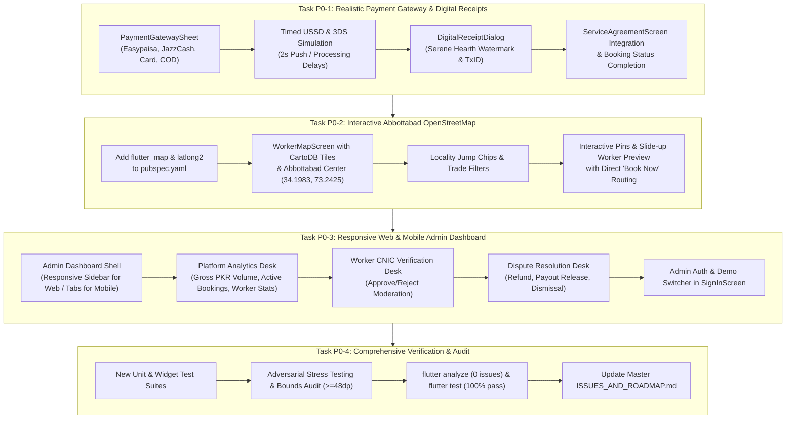

# 📋 HomeEase — Priority 0 (Critical Committee Directives) Implementation Plan

> **For Claude / Antigravity:** REQUIRED SUB-SKILL: Use executing-plans to implement this plan task-by-task.

**Goal:** Deliver the final, highest-priority FYP committee showstoppers for HomeEase: a realistic multi-channel Pakistani & global payment gateway simulation with digital receipts, an interactive Abbottabad OpenStreetMap worker discovery experience with CartoDB tiles and locality filters, and a responsive Web/Mobile Admin Governance & Moderation Dashboard with live analytics, worker CNIC verification, and dispute resolution.

**Architecture:** Clean Flutter layered architecture adhering to the Serene Hearth design system. Real-time data synchronization with Supabase backend (`ppuenornykkqgdxufrkg`), reactive singletons (`BookingRepository`, `WorkerRepository`, `DisputeRepository`), dual-screen responsive web/desktop & mobile layouts, and deterministic offline-safe fallback caches.

**Tech Stack:** Flutter 3.41.4, Dart 3.11.1, `flutter_map: ^7.0.2`, `latlong2: ^0.9.1`, `supabase_flutter: ^2.8.0`, `image_picker: ^1.1.2`, `url_launcher: ^6.3.1`, `flutter_animate: ^4.5.2`.

---

## 🗂️ Task Breakdown & Execution Sequencing

---

## 📦 Detailed Task Specifications

### Task P0-1: Realistic Pakistani & Global Payment Gateway Simulation & Serene Hearth Receipt

**Files:**
- Create: `lib/widgets/payment_gateway_sheet.dart`
- Create: `lib/widgets/digital_receipt_dialog.dart`
- Modify: `lib/screens/service_agreement_screen.dart`
- Modify: `lib/services/booking_repository.dart`
- Test: `test/priority0_payment_gateway_test.dart`

**Specifications:**
1. **`PaymentGatewaySheet`:**
   - 4 selectable payment channels with distinctive brand badges:
     - 🟢 **Easypaisa:** Pakistani mobile account number input (`03XXXXXXXXX`), 5-digit PIN input, 2-second simulated USSD prompt overlay ("Please check your phone screen to authorize payment of PKR X,XXX to HomeEase Escrow"), generates TxID `EP-XXXXXXXX`.
     - 🟠 **JazzCash:** Pakistani mobile account number input (`03XXXXXXXXX`), 4-digit MPIN input, 2-second processing spinner, generates TxID `JC-XXXXXXXX`.
     - 🔵 **Stripe Card:** 16-digit card input with Luhn validation indicator, expiry date (MM/YY), 3-digit CVC, Visa/Mastercard brand icon detection, 2-second simulated 3D Secure verification dialog, generates TxID `ch_3M...`.
     - 💵 **Cash on Delivery:** Mutual cash agreement note, terms acknowledgment checkbox, generates TxID `COD-XXXXXXXX`.
   - Responsive touch targets $\ge 48 \times 48\text{dp}$.
   - Full Urdu RTL and English LTR bilingual text via `LocalizationService`.
2. **`DigitalReceiptDialog`:**
   - Branded Serene Hearth modal dialog with emerald pine-teal styling.
   - Watermark stamp ("PAID / ادا شدہ"), verified checkmark icon.
   - Summary fields: Transaction Reference ID, Booking ID, Service Category, Worker Name & Avatar, Household Name, Date & Time, Payment Method, Total Paid in PKR.
   - Action buttons: "Save / Share Receipt" (shows feedback SnackBar) and "Done".
3. **Integration in `ServiceAgreementScreen`:**
   - In Household View when status is `'In Progress'` (or payment is due), tapping "Confirm Payment" displays `PaymentGatewaySheet`.
   - On successful payment simulation, `BookingRepository` updates booking status to `'Completed'`, `paymentStatus = 'confirmed'`, sets `paymentMethod` and `transactionId`.
   - Displays `DigitalReceiptDialog` and provides seamless feedback.

---

### Task P0-2: Interactive Abbottabad OpenStreetMap Worker Discovery

**Files:**
- Modify: `pubspec.yaml` (add `flutter_map: ^7.0.2` and `latlong2: ^0.9.1`)
- Create: `lib/screens/worker_map_screen.dart`
- Modify: `lib/screens/home_search_screen.dart`
- Modify: `lib/app/home_ease_flow.dart`
- Test: `test/priority0_worker_map_test.dart`

**Specifications:**
1. **Dependencies:**
   - Add `flutter_map: ^7.0.2` and `latlong2: ^0.9.1` to `pubspec.yaml` and run `flutter pub get`.
2. **`WorkerMapScreen`:**
   - Map centered on Abbottabad coordinates: `LatLng(34.1983, 73.2425)`.
   - Tile Layer: CartoDB Voyager raster tiles (`https://{s}.basemaps.cartocdn.com/rastertiles/voyager/{z}/{x}/{y}@2x.png`) with clean fallback to OpenStreetMap tiles (`https://tile.openstreetmap.org/{z}/{x}/{y}.png`), User-Agent `com.homeease.app`.
   - Abbottabad Locality Jump Chips (Horizontal scrollable carousel):
     - `All Abbottabad` (`34.1983, 73.2425`)
     - `Mandian` (`34.1983, 73.2425`)
     - `Jhangi Syedan` (`34.1750, 73.2280`)
     - `Supply Bazaar` (`34.1580, 73.2190`)
     - `Nawan Shehr` (`34.1620, 73.2650`)
     - `PMA Kakul Road` (`34.1890, 73.2590`)
     - Tapping a locality chip smoothly animates map center to the chosen location.
   - Trade Category Filter Chips:
     - `All`, `Cook`, `Cleaner`, `Nanny`, `Caregiver`, `Maid`, `Electrician`, `Plumber`.
   - Interactive Marker Layer:
     - Worker pins placed at their exact Abbottabad coordinates from `SampleData` / `WorkerRepository`.
     - Distinctive trade icons and rating stars on pins.
     - Tapping a pin highlights it and presents a bottom slide-up preview card.
   - Worker Quick-Preview Card:
     - Worker avatar, name, verification checkmark, trade role, rating and reviews count.
     - Dynamic distance calculation in km (via `latlong2.Distance`).
     - Hourly/visit rate in PKR.
     - Primary "Book Now" / "View Profile" button routing directly to `WorkerDetailScreen`.
   - Controls:
     - Zoom in/out buttons, Abbottabad re-center button, list view toggle button, back button, and language switcher.
     - Touch targets strictly $\ge 48 \times 48\text{dp}$.
3. **Integration in `HomeSearchScreen` & `HomeEaseFlow`:**
   - Add `AppStage.workerMap` to `AppStage`.
   - Add "Map View" (`نقشہ دیکھیں`) button in the curved pine-teal header and a floating action pill.
   - Wire `onOpenMap: () => _goTo(AppStage.workerMap)` in `HomeEaseFlow`.

---

### Task P0-3: Responsive Web & Mobile Admin Governance & Moderation Dashboard

**Files:**
- Create: `lib/screens/admin_dashboard_screen.dart`
- Modify: `lib/screens/sign_in_screen.dart`
- Modify: `lib/app/home_ease_flow.dart`
- Modify: `lib/services/worker_repository.dart`
- Modify: `lib/services/dispute_repository.dart`
- Test: `test/priority0_admin_dashboard_test.dart`

**Specifications:**
1. **Responsive Dual-Screen Layout:**
   - Desktop / Web Widescreen ($\ge 900\text{dp}$):
     - Persistent left navigation sidebar with Serene Hearth Admin branding, admin avatar, active tab selector, and quick stats summary.
     - Main content area with wide cards, data tables, and high-density metric widgets.
   - Mobile / Compact Screen ($< 900\text{dp}$):
     - Top navigation bar, tab selector / bottom bar, and vertical responsive cards.
2. **Tab 1: Platform Analytics & Financial Metrics:**
   - Gross Merchandise Volume (GMV): $\sum \text{agreedAmount}$ across all completed bookings.
   - Key Performance Indicators: Total Bookings, Active In-Progress Bookings, Active Disputes, Total Registered Workers, Total Households.
   - Visual category distribution breakdown bars (Cook, Cleaner, Nanny, etc.).
3. **Tab 2: Worker Verification Moderation Desk:**
   - Lists workers pending verification (`verificationStatus == 'PendingVerification'`).
   - Displays worker details: Name, CNIC number (`38403-...`), trade category, experience years, locality, and clearance status.
   - Action controls:
     - "Approve Verification" $\rightarrow$ Updates `verificationStatus = 'Verified'`, notifies worker, persists to Supabase `worker_profiles`.
     - "Reject / Request Resubmission" $\rightarrow$ Updates `verificationStatus = 'RejectedVerification'`.
4. **Tab 3: Dispute Resolution Desk:**
   - Live stream of all disputes from `DisputeRepository` (`public.disputes`).
   - Cards display complainant, respondent, dispute category, description, and attached evidence photo thumbnail.
   - Adjudication actions with prompt:
     - "Refund Household" $\rightarrow$ Closes dispute as `'resolved_refund'`, marks booking as `'refunded'`.
     - "Release Payment to Worker" $\rightarrow$ Closes dispute as `'resolved_payout'`, marks booking as `'confirmed'`.
     - "Dismiss Dispute" $\rightarrow$ Closes dispute as `'dismissed'`.
   - Live synchronization with Supabase and local repository state.
5. **Tab 4: System Audit Logs:**
   - Chronological event timeline recording recent registrations, booking settlements, and admin actions.
6. **Authentication & Quick Role Switcher:**
   - In `SignInScreen`, add `Admin` role to the tab selector (`[Household] [Worker] [Admin]`).
   - Add 1-tap "Quick Demo Admin Login" button (`admin@homeease.com` / `admin123`) for seamless committee demonstrations.
   - Wire `AppStage.adminDashboard` in `HomeEaseFlow`.

---

### Task P0-4: Comprehensive Verification, Adversarial Stress Testing & Audit

**Files:**
- Create: `test/challenger_priority0_stress_test.dart`
- Modify: `ISSUES_AND_ROADMAP.md`
- Run: `flutter analyze`
- Run: `flutter test`

**Verification Criteria:**
1. Zero analyzer errors or warnings (`flutter analyze`).
2. 100% test pass rate across the full test suite (baseline 403 + new P0 tests $\ge 480$).
3. All UI touch targets strictly $\ge 48 \times 48\text{dp}$.
4. Full bi-directional text and layout support in English (LTR) and Urdu (RTL).
5. All 3 payment channels generate realistic TxIDs and complete bookings with digital receipts.
6. Abbottabad map renders CartoDB tiles, filters localities, and enables direct booking.
7. Admin dashboard functions seamlessly on both Web and Mobile layouts with live metrics and moderation.
8. Master `ISSUES_AND_ROADMAP.md` marked 100% complete across all priorities (P3, P2, P1, P0).
