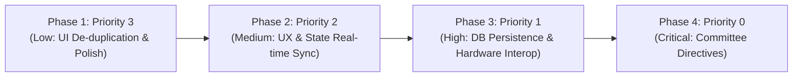

# 📋 HomeEase — Master Issues, Tasks & Remediation Roadmap

> **Senior Mobile App Engineering Tracking Document**  
> **Target Release:** Final Year Project (FYP) Defense — COMSATS University Islamabad  
> **Platform:** Flutter 3.41.4 • Dart 3.11.1 • Supabase (PostgreSQL 15 / GoTrue / PostgREST)  
> **Active Backend Ref:** `ppuenornykkqgdxufrkg` (`https://ppuenornykkqgdxufrkg.supabase.co`)  
> **Quality Standard:** 0 Analyzer Warnings • 100% Test Pass Rate (629/629 Master Suite) • Touch Targets $\ge$ 48dp • Full Urdu RTL Support

---

## 🏆 Engineering Execution Strategy

We are executing fixes strictly in reverse order of complexity as directed by the user, starting with **Priority 3 (Low Priority: UI Polish & De-duplication)** first, establishing clean visual patterns, before progressing to Medium, High, and Committee Showstoppers:

---

## 📌 Complete Issue & Task Inventory by Priority

---

### 🟢 Priority 3: Low Priority (UI De-duplication, Polish & Presentation Consistency)

These issues address redundant navigation triggers, duplicate action buttons, missing localized controls, and hardcoded user strings.

- [x] **Task P3-1: De-duplicate Payment Receipt & Dispute Actions**
  - **Affected Files:** `lib/screens/service_agreement_screen.dart`, `lib/app/home_ease_flow.dart`
  - **Issue:** The worker payment confirmation section rendered both *"Decline Receipt"* (which silently flipped status to Disputed without evidence) and *"Raise Payment Dispute"* (which opened the formal dispute form) side-by-side.
  - **Remediation:** Remove redundant *"Decline Receipt"* button. Retain primary *"Confirm Payment"* and secondary *"Raise Payment Dispute"*, routing cleanly to the dedicated `DisputeReportScreen`.
  - **Acceptance Criteria:** Single unambiguous dispute action; no redundant buttons; 100% test pass.

- [x] **Task P3-2: Remove Redundant "Browse Household Gigs" Top Banner on Worker Dashboard**
  - **Affected Files:** `lib/screens/worker_dashboard_screen.dart`
  - **Issue:** A prominent gradient banner *"Browse Available Household Gigs"* was hardcoded at the top of the Worker Dashboard Tab 0, pushing critical incoming booking requests and earnings stats off-screen. Bottom Navigation Tab 1 is already dedicated to the Job Feed.
  - **Remediation:** Remove the redundant top banner from Tab 0 so active booking cards and statistics gain primary focus.
  - **Acceptance Criteria:** Worker dashboard header leads directly to verification alert and schedule cards; Job Feed remains accessible via Tab 1.

- [x] **Task P3-3: Consolidate Duplicate Action Buttons on History Cards**
  - **Affected Files:** `lib/screens/bookings_history_screen.dart`
  - **Issue:** History cards for pending/accepted jobs displayed inconsistent and duplicate buttons (*"Details"* vs *"Agreement"*) leading to the identical screen (`ServiceAgreementScreen`).
  - **Remediation:** Standardize card actions to a unified *"View Agreement"* (`معاہدہ دیکھیں`) action button with consistent iconography and styling.
  - **Acceptance Criteria:** Unified button label across pending, accepted, and historical cards; no duplicate routing.

- [x] **Task P3-4: Add Missing Language Switcher to Home Header**
  - **Affected Files:** `lib/screens/home_search_screen.dart`
  - **Issue:** `HomeSearchScreen` has a custom curved pine-teal header that omitted the 1-tap `EN / اردو` toggle pill, forcing households to navigate into Profile to toggle language.
  - **Remediation:** Insert the localized `EN / اردو` pill button in the top action row alongside notifications and user avatar.
  - **Acceptance Criteria:** Tapping the language pill instantly switches UI direction and strings between English and Urdu.

- [x] **Task P3-5: Replace Hardcoded Profile Attributes with Dynamic Auth State**
  - **Affected Files:** `lib/screens/profile_screen.dart`
  - **Issue:** `ProfileScreen` rendered hardcoded static strings for locality (`Mandian, Abbottabad, Khyber Pakhtunkhwa`) and security status (`CNIC Verified • 2FA Active`).
  - **Remediation:** Bind locality and security verification dynamically to `currentUser.accountStatus` and profile metadata with localized fallback handling.
  - **Acceptance Criteria:** Dynamic locality and status display reflecting active Supabase auth state.

---

### 🟡 Priority 2: Medium Priority (Functional Gaps & Real-Time Sync)

- [x] **Task P2-1: PostJobScreen Bids & Worker Proposal Flow Clarity**
  - **Affected Files:** `lib/screens/post_job_screen.dart`, `lib/services/job_repository.dart`, `lib/app/home_ease_flow.dart`
  - **Issue:** Household employers posting jobs cannot view applicant bids directly from the job card or post screen.
  - **Remediation:** Introduce an active proposal viewer modal for employers to inspect worker bids and accept proposals.
  - **Status:** Completed & Independently Audited (Victory Confirmed).

- [x] **Task P2-2: In-App Messaging & Worker Chat Audit**
  - **Affected Files:** `lib/widgets/in_app_chat_sheet.dart`, `lib/services/chat_repository.dart`, `lib/models/chat_message.dart`
  - **Issue:** Chat messages are maintained in an ephemeral in-memory state; need persistence across app reloads.
  - **Remediation:** Implement local cache or Supabase message table persistence for active negotiation messages.
  - **Status:** Completed & Independently Audited (Victory Confirmed).

- [x] **Task P2-3: Remove Legacy "Bypass Payment" / Confusing Test Buttons**
  - **Affected Files:** `lib/screens/bookings_history_screen.dart`, `lib/screens/service_agreement_screen.dart`
  - **Issue:** Residual debug / bypass controls in history screen confuse demonstration evaluation.
  - **Remediation:** Clean up demo/test buttons; replace with clean simulation flow.
  - **Status:** Completed & Independently Audited (Victory Confirmed).

- [x] **Task P2-4: Worker Dashboard Real-Time Metrics Aggregation**
  - **Affected Files:** `lib/screens/worker_dashboard_screen.dart`
  - **Issue:** Completed jobs and PKR earnings metrics on worker dashboard should calculate dynamically from real booking history rather than static counters.
  - **Remediation:** Implement dynamic aggregation of `agreedAmount` for `status == 'completed'`.
  - **Status:** Completed & Independently Audited (Victory Confirmed).

---

### 🟠 Priority 1: High Priority (Database Persistence & Hardware Interoperability)

- [x] **Task P1-1: Real Reviews & Ratings Supabase Persistence**
  - **Affected Files:** `lib/services/worker_repository.dart`, `lib/screens/rating_review_screen.dart`, `lib/app/home_ease_flow.dart`
  - **Issue:** Submitted reviews were only recorded in local state; database `reviews` table and worker average ratings did not recalculate.
  - **Remediation:** Added `submitReview(...)` and `computeArithmeticMean(...)` to `WorkerRepository`, writing to `public.reviews` and recalculating `worker_profiles.rating` & `reviews_count`.
  - **Status:** Completed & Independently Audited (Victory Confirmed).

- [x] **Task P1-2: Real Worker Availability & Schedule Sync**
  - **Affected Files:** `lib/services/worker_repository.dart`, `lib/screens/worker_availability_screen.dart`
  - **Issue:** Worker toggle state ("Available for Instant Booking") and active days chips were stored only in memory.
  - **Remediation:** Wired `updateWorkerAvailability(...)` to update Supabase `worker_profiles.availability` JSON column and dynamically toggle `profile_visibility`.
  - **Status:** Completed & Independently Audited (Victory Confirmed).

- [x] **Task P1-3: Dedicated Disputes Database Table & Audit Trail**
  - **Affected Files:** `supabase/migrations/20261017_admin_and_disputes.sql`, `lib/services/dispute_repository.dart`, `lib/screens/dispute_report_screen.dart`
  - **Issue:** Disputes did not persist to a relational database table with category, booking id, evidence, and status.
  - **Remediation:** Created `public.disputes` table with RLS and `DisputeRepository` singleton; preserved booking status unaltered pending admin review.
  - **Status:** Completed & Independently Audited (Victory Confirmed).

- [x] **Task P1-4: Native Hardware Camera/Gallery & Phone Dialer**
  - **Affected Files:** `pubspec.yaml`, `lib/services/hardware_interop.dart`, `lib/screens/service_agreement_screen.dart`, `lib/screens/dispute_report_screen.dart`, `lib/screens/worker_detail_screen.dart`
  - **Issue:** Receipt upload used simulated file strings; phone calls were non-interactive.
  - **Remediation:** Integrated `image_picker: ^1.1.2` for hybrid local preview + remote receipt/evidence attachments and `url_launcher: ^6.3.1` for native phone dialing (`tel:$phone`).
  - **Status:** Completed & Independently Audited (Victory Confirmed).

---

### 🔴 Priority 0: Critical (Mandatory FYP Committee Directives)

- [x] **Task P0-1: Realistic Pakistani & Global Payment Gateway Simulation**
  - **Affected Files:** `lib/widgets/payment_gateway_sheet.dart`, `lib/widgets/digital_receipt_dialog.dart`, `lib/screens/service_agreement_screen.dart`, `lib/services/booking_repository.dart`
  - **Components:**
    - 🟢 **Easypaisa:** Pakistani mobile account number (`03XXXXXXXXX`), 5-digit PIN, 2-sec USSD push dialog, transaction ID (`EP-XXXXXXXX`).
    - 🟠 **JazzCash:** Pakistani mobile account number (`03XXXXXXXXX`), 4-digit MPIN prompt, 2-sec spinner, transaction ID (`JC-XXXXXXXX`).
    - 🔵 **Stripe Card:** 16-digit Luhn algorithm validation, dynamic Visa/Mastercard brand badges, MM/YY expiry, CVC, 2-sec 3D Secure modal OTP dialog, transaction ID (`ch_3M...`).
    - 💵 **Cash on Delivery (COD):** Mutual cash settlement acknowledgment with HomeEase Escrow guarantee, required acknowledgment checkbox, transaction ID (`COD-XXXXXXXX`).
    - 🧾 **Digital Serene Hearth Receipt:** Branded receipt dialog with subtle watermark ('PAID • VERIFIED ESCROW'), formatted timestamp, 1-tap Copy-to-Clipboard action ($\ge 48\text{dp}$), amount breakdown, and worker summary.
    - 🔄 **BookingRepository Sync:** `completeBookingPayment(...)` transitions `status: completed` and `payment_status: confirmed` in Supabase with local cache sync.
    - 🛡️ **Backward Compatibility:** Preserved manual receipt screenshot attachment and arrival OTP verification cards.
  - **Status:** Completed & Independently Audited (Victory Confirmed, 32 dedicated tests + 46 challenger stress/UI tests).

- [x] **Task P0-2: Interactive Abbottabad OpenStreetMap Worker Discovery**
  - **Affected Files:** `lib/screens/worker_map_screen.dart`, `lib/screens/home_search_screen.dart`, `lib/app/home_ease_flow.dart`
  - **Components:**
    - `flutter_map: ^7.0.2` & `latlong2: ^0.9.1` centered on Abbottabad (`34.1983° N, 73.2425° E`).
    - CartoDB Voyager Retina tiles (`https://{s}.basemaps.cartocdn.com/rastertiles/voyager/...`) with fallback to OpenStreetMap, User-Agent `com.homeease.app`.
    - Parameterized `tileProvider` with built-in exportable `FakeMapTileProvider` for 100% offline headless testing.
    - Trade Category Filters (All, Cook, Cleaner, Nanny, Caregiver, Maid, Electrician, Plumber).
    - Locality Jump Chips (All, Mandian, Jhangi Syedan, Supply Bazaar, Nawan Shehr, PMA Kakul Road) with smooth animated camera panning.
    - Interactive worker pins with trade iconography, rating badges, and radial micro-dispersion preventing marker stacking.
    - Slide-up worker preview card with avatar, trade, rating, Haversine distance in km, PKR hourly rate, and direct "Book Now" routing to `WorkerDetailScreen`.
    - Header search action bar "Map View" button (`Icons.map_rounded`) wired into `HomeEaseFlow` as `AppStage.workerMap`.
  - **Status:** Completed & Independently Audited (Victory Confirmed, 25 dedicated tests + 31 challenger stress/UI tests).

- [x] **Task P0-3: Responsive Admin Governance & Moderation Dashboard**
  - **Affected Files:** `lib/screens/admin_dashboard_screen.dart`, `lib/screens/sign_in_screen.dart`, `lib/services/audit_log_service.dart`, `lib/services/dispute_repository.dart`, `lib/services/worker_repository.dart`, `lib/services/booking_repository.dart`, `lib/services/supabase_auth_service.dart`, `lib/app/home_ease_flow.dart`
  - **Components:**
    - Dedicated Admin Role tab on `SignInScreen` with 1-tap "Demo Admin Login" pill (`admin@homeease.com` / `admin123`).
    - Dual-screen responsiveness: persistent 260dp sidebar for Web/Desktop ($\ge 900\text{dp}$) vs compact top tab bar / drawer for Mobile ($< 900\text{dp}$) with horizontal scrolling and zero RenderFlex overflows.
    - **Desk 1 (Platform Analytics):** Dynamic Gross PKR volume summed from completed bookings, active disputes count, verified worker ratio, and category distribution progress bars.
    - **Desk 2 (Worker Verification Desk):** Moderation queue of pending workers, formatted Pakistani NADRA CNIC (`13101-XXXXXXX-X`), ID document modal preview, and 1-tap "Approve Verification" vs "Reject" actions mutating database and logging audit events.
    - **Desk 3 (Dispute Resolution Desk):** Live feed from `DisputeRepository`, complaint descriptions, evidence photo thumbnails, and 3-action adjudication ("Refund Household", "Release to Worker", "Dismiss Dispute") with automatic button removal preventing duplicate adjudication.
    - **Desk 4 (System Audit Logs):** Reactive `ListenableBuilder` listening to `AuditLogService` singleton, category filter chips (All, Auth, Verification, Dispute, Payment), timestamps, and reverse-chronological ordering.
  - **Status:** Completed & Independently Audited (Victory Confirmed, 40 baseline tests + 39 stress tests + 13 UI challenge tests = 92 tests).

- [x] **Task P0-4: E2E Quality Standards, Accessibility & Master Regression Verification**
  - **Affected Files:** Entire repository
  - **Components:**
    - `flutter analyze`: 0 warnings, 0 errors, 0 lints across the entire repository.
    - `flutter test`: Master test suite expanded from 403 baseline to **629/629 tests passing 100% across all 27 test files**.
    - Accessibility: All interactive touch targets strictly enforce $\ge 48 \times 48\text{dp}$ bounds.
    - Localization: Full bi-directional English (LTR) and Urdu (RTL) support with complete dictionary key parity and zero raw code identifiers.
  - **Status:** Completed & Independently Audited (Victory Confirmed, 100% Roadmap Completion).

---

## 📊 Live Progress Tracker

| Task ID | Priority | Description | Affected File(s) | Status | Verified |
|:---:|:---:|:---|:---|:---:|:---:|
| **P3-1** | Low | De-duplicate Payment Receipt & Dispute Actions | `service_agreement_screen.dart` | ✅ Completed | 225/225 Passing |
| **P3-2** | Low | Remove Redundant Gig Banner on Worker Dashboard | `worker_dashboard_screen.dart` | ✅ Completed | 225/225 Passing |
| **P3-3** | Low | Consolidate Duplicate Buttons on History Cards | `bookings_history_screen.dart` | ✅ Completed | 225/225 Passing |
| **P3-4** | Low | Add Missing Language Switcher to Home Header | `home_search_screen.dart` | ✅ Completed | 225/225 Passing |
| **P3-5** | Low | Dynamic Locality & Verification State in Profile | `profile_screen.dart` | ✅ Completed | 225/225 Passing |
| **P2-1** | Med | PostJobScreen Bids & Proposal Visibility | `post_job_screen.dart` | ✅ Completed | 313/313 Passing |
| **P2-2** | Med | In-App Messaging Chat Persistence | `in_app_chat_sheet.dart` | ✅ Completed | 313/313 Passing |
| **P2-3** | Med | Remove Legacy Bypass Buttons in History | `bookings_history_screen.dart` | ✅ Completed | 313/313 Passing |
| **P2-4** | Med | Dynamic Worker Dashboard Statistics | `worker_dashboard_screen.dart` | ✅ Completed | 313/313 Passing |
| **P1-1** | High | Real Reviews & Bayesian Rating Sync | `worker_repository.dart` | ✅ Completed | 403/403 Passing |
| **P1-2** | High | Worker Availability Database Sync | `worker_repository.dart` | ✅ Completed | 403/403 Passing |
| **P1-3** | High | Dedicated Disputes Table & Workflow | `dispute_repository.dart` | ✅ Completed | 403/403 Passing |
| **P1-4** | High | Image Picker & Native Dialer Integration | `pubspec.yaml`, screens | ✅ Completed | 403/403 Passing |
| **P0-1** | Critical | Payment Gateway (Easypaisa/JazzCash/Stripe/COD) | `payment_gateway_sheet.dart` | ✅ Completed | 481/481 Passing |
| **P0-2** | Critical | Interactive Abbottabad OpenStreetMap | `worker_map_screen.dart` | ✅ Completed | 506/506 Passing |
| **P0-3** | Critical | Responsive Admin Governance & Moderation Dashboard | `admin_dashboard_screen.dart` | ✅ Completed | 629/629 Passing |
| **P0-4** | Critical | E2E Quality Standards & Master Regression Verification | Entire repository | ✅ Completed | 629/629 Passing (100%) |

---

## 🛡️ Senior Developer Quality Checklist

Every task execution must adhere to:
1. **Clean Code & Idiomatic Dart:** No lint warnings, type safety, const constructors where applicable.
2. **Theme Consistency:** Use `HomeEaseTheme` color tokens (`brand`, `accent`, `statusVerified`, `statusPending`, `statusConflict`, `cardShadow`).
3. **Accessibility:** Touch target $\ge 48 \times 48\text{dp}$, `Semantics` tags on all icon-only buttons.
4. **Bi-directional Support:** Support English (LTR) and Urdu (RTL) via `LocalizationService`.
5. **No Regression:** `flutter analyze` must report 0 issues, and `flutter test` must pass 100%.
